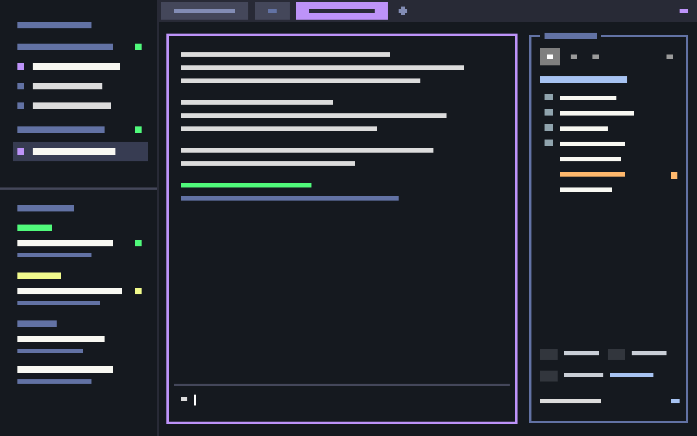

# herdr-tui

A layout for the [Herdr](https://herdr.dev) app that brings back the look of the Herdr 0.9.5 terminal UI with the dracula theme.
It has flat numbered tab cells, square pane frames that turn purple when focused, and a right sidebar with a file tree, search and replace, git changes and an editor picker.

## Install

In the Herdr app, ask your agent:

> Add the layout herdr.dev/layouts/HuangYujun-JunkyTalent/herdr-tui

The agent follows the steps in the app's `AGENTS.md`.
It copies `layouts/`, `themes/` and `mods/` into `~/.config/herdr-app/` and merges `keys.json`.
Then it switches to the layout.
To go back to your own layout, open the layout switcher (cmd-shift-l on macOS).

To install by hand, copy the same folders into `~/.config/herdr-app/` without overwriting anything.
Add the section of `keys.json` to your own `keys.json`.
Then pick herdr-tui under Settings → Layout.

## Requirements

- The font [MesloLGS NF](https://github.com/romkatv/powerlevel10k#fonts), for the text and the Nerd Font icons. Without it, the icons show as boxes.
- macOS, for the right-click "Open in …" apps and the editor picker. On other systems, the sidebar offers its own preview, terminal editors and Herdr tabs.
- Optional: `rg` makes search faster; without it, search uses `grep`.

## What's in it

| Part | What it does |
|---|---|
| `layouts/herdr-tui.json` | The layout: a left column, the tab bar, the panes, and a right sidebar that is hidden at first |
| `themes/herdr-tui.json` | Dark `#15191f` with dracula accents |
| `mods/tui-tabs` | The tab bar of the TUI: flat cells, a number on every tab, drag with an insert marker |
| `mods/tui-spaces` | Machines and spaces, with `▸` for the active space |
| `mods/tui-agents-list` | Agents led by their tab names, on two lines or one wrapped line |
| `mods/tui-menu` | The right-click menu, with one highlight for both mouse and keys |
| `mods/tui-sidebar` | The file tree, VS Code-style search and replace, and the editor picker |
| `mods/tui-changes` | The git changes, in the frame of the sidebar |
| `mods/tui-open` | The sidebar's right-click menu: Finder, terminals, editors, copy path |

`RECIPE.md` describes the whole layout in detail, so that an agent can rebuild it from scratch.

## Keys

| Key | Where | Action |
|---|---|---|
| cmd-e | anywhere | Show or hide the right sidebar |
| cmd-shift-e | anywhere | Move the keyboard to the sidebar and back |
| ↑ ↓ ← → or j k h l | sidebar | Move and fold; ↑ from the top selects the root folder |
| Enter | sidebar | Open the file, or the menu on the root |
| f / t / v | sidebar | Open the folder in Finder, a terminal or the editor |
| n / s | sidebar | Open the folder in a new Herdr tab or split |
| y / p | sidebar | Copy the path or the relative path |
| m | sidebar | Open the menu |
| 1 / 2 / 3 | sidebar | Files, search, git |
| e | sidebar | Choose the editor |
| Escape | sidebar | Go back to the pane |

## What the mods run

The mods run `git`, `rg` or `grep`, and `perl` (for Replace) in the folders you open, on the machine of the space.
On your Mac, they run `open`, `pbcopy` and the apps you pick from the menus.
For a space on another machine, they reach it over SSH through Herdr, and nothing else goes over the network.

## Credits

Built on the shipped mods of the Herdr app, and drawn after the Herdr 0.9.5 TUI.
Colors from the [Dracula](https://draculatheme.com) theme.

## License

Copyright 2026 Yujun Huang.
Licensed under the [Apache License 2.0](LICENSE), the license of the Herdr app.
Six of the mods are modified from the mods that ship with the Herdr app, and the first line of each says which.
