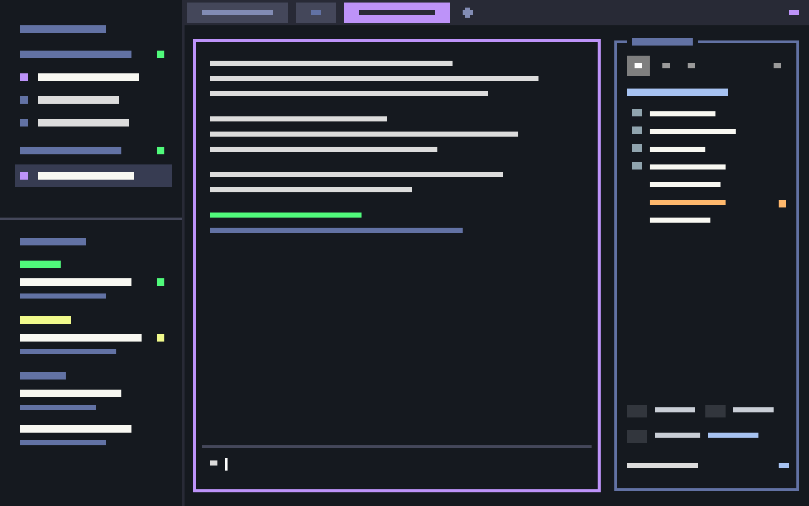

# Herdr TUI

The look of the Herdr 0.9.5 terminal UI with the dracula theme, in the Herdr app.
The window has a dark, square frame: a narrow list of machines, spaces and agents on the left, and a one-row tab bar of flat colored cells above the panes.
Panes have thin square borders that turn purple when focused.
A sidebar on the right, opened with cmd-e, has a file tree, a VS Code-style search and replace, the git changes, and a picker for the editor that opens files.



## What you see

Left to right:

1. **The left column**, 232 px, background `#15191f`, not resizable. The brand block and the status bar of the shipped layout are hidden.
   - **Spaces** (`tui-spaces`), headed "machines". Each machine is a header row with `+` and a status dot. Each space under it is led by `▸` when active and `·` otherwise, instead of the letter avatars of the shipped mod. Corners are square.
   - **Agents** (`tui-agents-list`), grouped by status (Done, Working, Idle, …). Each row leads with the name of its tab at 12 px, or with the agent's own title when the tab has no name. Below it come the facts, joined by ` · `: the machine ("Local" for this one), the space (when it doesn't fit otherwise), the program and the time.
     Under a Claude Code agent on this Mac, foldable tree rows list the subagents (`◇`) and background shells (`$`) of its session, at most eight. A row stays while its task runs and leaves once the session has the result; a failed task stays until it is opened or stopped. A click on a shell opens a window with a bar (state and ■ Stop on the left; the title; − and + to shrink or grow the window by 15 %, and × on the right) over a real terminal that follows the output with `tail -f`; Stop, or ctrl-c in that terminal, kills the processes that write the output, and closing the window ends only that terminal, never the shell; closing a subagent window leaves the subagent running. A click on a subagent opens a window of its latest steps, refreshed every 2 s, with a box whose message is typed into the parent Claude Code (`hc send`), asking it to pass the message on with SendMessage. A window opens wide enough for its title, up to 1100 px, and only a longer title turns round. cmd-shift-x closes the newest task window, and closing never stops the task; cmd-alt-= or cmd-alt-+ and cmd-alt-- grow and shrink it. A resize, by key or button, is done by the agents list, which closes the window and opens it again under the same key, so it keeps its place; a window that reopens itself under its own key closes instead. Both windows close by themselves when the task ends and when another tab is chosen; the sort menu's "Close task windows" section turns each off (the shared values `tui-agents.close-on-end` and `tui-agents.close-on-leave`).
   - The shipped footer (`workspace-chrome` with `footer: true`): Settings and Add machine.
2. **The work column.**
   - **The tab bar** (`tui-tabs`), 18 px, background `#282a36`. Tabs are flat cells, `#44475a`, with text `#828cb4` (named) or `#6272a4` (unnamed). The focused tab is `#bd93f9` with text `#282a36`, bold when named. A tab is as wide as its label plus four cells, and at least eight; one cell is 7.8 px. The label is centered and always starts with the tab's number (`2`, or `3 Claude Code`), so cmd-number is easy to read. A `●` follows the label when the tab is blocked or done. `+` sits right after the last tab. At the far right, `«` or `»` shows or hides the right sidebar.
   - **The panes**: padding [2, 4], square borders `#44475a`, focused `#bd93f9`. A lone pane keeps its frame. There are no pane headers.
   - **The right sidebar**, 340 px (min 240, max 900), hidden by default. It's a stack of two blocks:
     - `files` (`tui-sidebar`): a frame `#6272a4` (purple and bold when focused) with the title "Sidebar" set into its top line, as the TUI draws it. Below it are four view icons (Nerd Font glyphs; inactive `#9a9a9a`, active white on `#7f7f7f`): files, search, git and settings. Then come the root folder's name in caps, the tree, the key hints, the editor picker ("e open in VS Code ▴") and a footer with the branch, `⟳ behind↓ ahead↑` and `«` to hide.
     - `changes` (`tui-changes`): the shipped Changes view inside the same frame and icons, so the folder, search and gear icons lead back to `files`.
3. **Theme** `herdr-tui`: background `#15191f`, foreground `#dcdcdc`, the ANSI colors of an iTerm2 profile, and dracula accents: `#bd93f9` accent, `#f1fa8c` working, `#ff5555` blocked, `#50fa7b` done, `#6272a4` muted.
4. **Fonts**: MesloLGS NF, 13 px, for terminals and UI.

## How it behaves

- **Agent status** follows the theme: working is yellow, blocked red, done green, idle and unknown `#6272a4`. On a tab, blocked and done add a `●` in that color.
- **Tabs**: a click selects; a double click renames; a right-click opens `tui-menu` (Rename, New tab, Close); the scroll wheel goes to the next or previous tab. To move a tab, drag it: while held, a 2 px accent bar shows where it will land, in the gap before or after the tab under the pointer, and letting go there moves it (`tab.move`). `+` opens the shipped `new-menu`. A new tab always lands last, however it was opened (cmd-t, `+`, a menu), as in the TUI: Herdr puts it right of the active tab, and `tui-tabs` then moves it to the end (`tab.move`).
- **Spaces**: a dragged space gets the background `#6272a4` while it moves. Its right-click menu is `tui-menu`.
- **Agents**: the sort menu (the clock icon) has a "Rows" section: "Two lines" or "One line, wrapped". The choice is the shared value `tui-agents.rows`. Its "Close task windows" section has "When the task ends" and "When I leave the tab", both on at first.
- **Menus** (`tui-menu`, also the terminal menu): one highlight only. The pointer moves the same choice as ↑/↓.
- **Right sidebar**:
  - cmd-e shows or hides it. cmd-shift-e shows it, gives it the keyboard, and on a second press gives the keyboard back to the pane that had it; Escape does the same. cmd-alt-arrows (`pane.go`) also reach it.
  - It remembers per space whether it's open, and which of files and changes it shows.
  - **Tree**: `▸`/`▾` folders and file glyphs. Git marks color names (M `#ffb86c`, A `#50fa7b`, D and U `#ff5555`) with a `●`; a folder takes the strongest mark below it. The root folder's name is a row too: it highlights on hover and can be selected with ↑ from the first row or ← from a top-level row.
  - **Keys**: ↑↓ or jk move, ←→ or hl fold, Enter opens (on the root, the menu), r refreshes, `.` shows dotfiles, e opens the editor picker, 1/2/3 switch to files, search and git, b hides. On the selected row or the root: f Finder, t terminal, v editor, n Herdr tab, s Herdr split, y copy path, p copy relative path, m or shift-F10 the menu.
  - **Right-click** on a row or the root name opens `tui-open`, which lists only apps installed on this Mac. A file shows "Reveal in Finder" and opens its own folder in a terminal. Entries, in order:
    - Finder, plus Path Finder, ForkLift, Commander One, QSpace Pro or Marta;
    - iTerm2, Terminal, Warp, Ghostty, WezTerm, kitty or Alacritty;
    - a new Herdr tab or split there;
    - VS Code, Cursor, Zed or Sublime Text;
    - Copy Path and Copy Relative Path.

    Each entry shows its key. For a space on another machine, only the Herdr tab and split, VS Code and Cursor over their SSH remote, and the copy items remain.
  - **Hover actions** over the tree, as in VS Code: New File, New Folder, Refresh, Collapse. New File and New Folder open an inline name field, refuse a name that exists, and a new file opens in the chosen editor.
  - **Search** (2 or the magnifier): a Search box with Aa (case), ab (word) and .* (regex), and a Replace box with "all", which asks "Replace N in M files?" first. The search starts 250 ms after the last key, with rg when the machine has it and grep otherwise. Results are grouped by file with a count, and the match is highlighted. A click opens the file at that line.
  - **Editor picker** (e or the gear): Preview (inside the sidebar), the installed apps among VS Code, Cursor, Zed, Sublime Text, BBEdit, Nova, TextMate and TextEdit, the terminal editors found with `command -v` (vim, Neovim, nano, Helix, micro, Emacs), which open in a split pane, and Default app. On another machine, only terminal editors on it and the apps with an SSH remote show. A saved choice that is missing falls back to Preview.

## Built from

- **Layout** `layouts/herdr-tui.json`, cloned from the shipped `main` (0.1.12). Root: a row with `theme: "herdr-tui"`, `font` and `ui_font` "MesloLGS NF", `font_size` 13, `terminal_padding` [2, 4], `terminal_menu: "tui-menu"`, and no `titlebar` key, so macOS draws its own title bar. `preview: "layouts/herdr-tui.svg"` is the 320×200 sketch that Settings shows for the layout, drawn in the colors of the theme.
  ```
  root (row)
    sidebar (column, 232 px): brand (hidden), sidebar-lists [spaces: tui-spaces, agents: tui-agents-list], sidebar-footer: workspace-chrome {footer}
    work (column): tabs (18 px): tui-tabs
                   work-body (row, padding [2,4], gap 8):
                     main: {tab: "active", pane: {radius 0, border, focus accent, lone}}, padding [8.5, 0]
                     panel (column, 340 px, hidden): panel-body (stack): files: tui-sidebar, changes: tui-changes
                   status (hidden): workspace-status
  ```
- **Theme** `themes/herdr-tui.json`.
- **Keys** `keys.json`: the section `layout:herdr-tui` with `cmd-e: layout.toggle:panel`, `cmd-shift-e: tui-sidebar.toggle-focus`, `cmd-shift-x: tui-agents-list.close-task`, `cmd-alt-=` and `cmd-alt-+: tui-agents-list.grow-task`, and `cmd-alt--: tui-agents-list.shrink-task`.
- **Mods**:
  - `tui-tabs`, from the shipped `tabs`. The cells and colors are those of Herdr 0.9.5 `src/client/shell/tabs.rs`. It calls `tab.select`, `tab.rename`, `tab.move`, `tab.prev` and `tab.next`, and `layout.toggle {id: "panel"}`. It keeps the shipped per-space panel memory.
  - `tui-spaces`, from `spaces`.
  - `tui-agents-list`, from `agents`.
  - `tui-menu`, from `menu`.
  - `tui-changes`, from `changes`. It sends `setShared("tui-sidebar.open", {view, at})` and `layout.select` to go back to `files`.
  - `tui-sidebar`, from `files`, focusable. It takes `focus` and `toggle-focus` from `nextCommand()`.
  - `tui-open`, the popup that gets `{items}` from `tui-sidebar`. Each item is `{label, glyph, key, exec | run}`.
  - Shipped mods used as they are: `workspace-chrome`, `workspace-status`, `new-menu`, `worktree`.
- **Programs** the mods run, on the space's machine unless noted:
  - `git` (status, branch, ahead and behind, diffs, worktree checks), `sh`, `rg` or `grep`, and `perl -pi` for Replace;
  - on this Mac: `open`, `pbcopy`, the CLIs inside VS Code and Cursor (`Contents/Resources/app/bin/code`), and the terminals' own CLIs (WezTerm, kitty, Alacritty);
  - `hc machine ls --json`, for the SSH target of a remote machine.
  - `hc get <terminal>`, for the pid of the Claude Code in a terminal, then `sh`, `grep`, `date` and `tail` on Claude Code's own files: `~/.claude/sessions/<pid>.json` names the session, `~/.claude/projects/*/<session>/subagents/*.meta.json` lists its subagents, and its transcript `<session>.jsonl` records each background shell, its output file and the `<task-notification>` that ends it. The agents list reloads them every 3 s. A shell window runs `hc run --bg --no-parent --rm -- sh -c <script> <output>`, a `tail -f` whose ctrl-c trap and the Stop button run `lsof` and `kill`.

  They read files of the open folders with `readTextFile` and watch them with `watchFolder`. Nothing reaches the network beyond SSH to your own machines.
- **Art**: Nerd Font glyphs (MesloLGS NF); the shipped SVGs `mods/pane/close.svg` and `mods/workspace-chrome/*.svg`; the window-button SVGs in `tui-tabs`.

## Watch out

- Write a new mod's `mod.json` (`"place": "none"`) before its `main.js`. A folder the app sees without one is docked into the shown layout as a 320 px block.
- `MouseMoveEvent.bounds` is `{x, y, width, height}`; `bounds.size.width` throws and breaks tab drag silently.
- `flex_shrink()` needs an argument; use `flex_shrink_1()`.
- With the theme's hover equal to popover, menu hovers are invisible; `hover` is `#323548` for that reason.
- The frame title must be drawn as two pieces of the top line, or the line strikes through it; both frames sit `ROW/2` (8.5 px) lower so their tops line up with the pane borders.
- The panel is hidden by default and its state lives in `layouts/.state/`. A restart that drops that file hides it, which is why the tab bar has the `«`/`»` button.
- The app draws text with thicker strokes than iTerm2, so the fonts look heavier than the TUI.
- The app has no cursor-shape setting, and herdr-core doesn't keep a shape a program set across a restart of the app. A shell that wants a bar cursor sends `ESC [ 5 q` itself.
- The editor and app detection is for macOS. Other systems get Preview, the terminal editors and the Herdr entries.
- Search draws at most about 600 rows, 2,000 lines and 50 per file.

## Done when

- `herdr-app check` passes for each of the seven mods, and `layout.switch {name: "herdr-tui"}` shows the tab bar as flat cells numbered `1`, `2`, … with the focused one purple.
- Dragging a tab shows the accent bar between tabs, and letting go moves the tab there.
- cmd-e opens the sidebar with the "Sidebar" frame title. cmd-shift-e focuses it (the frame turns purple), and a second press returns to the pane.
- ↑ from the first tree row selects the root name. f on it opens the folder in Finder, and a right-click on it lists the installed apps, each with its key.
- Typing in Search lists matches grouped by file, and a click opens that line in the chosen editor.
- The git icon shows Changes in the same frame, and the folder icon goes back to the tree.
- Right-clicking a tab or a space shows a menu with a single highlight that follows both pointer and arrows.
